# FieldDesk

[](https://github.com/IgorOdaryuk/fielddesk/actions/workflows/ci.yml)

Dispatch and job management for small field-service companies — appliance repair, HVAC, plumbing — where a dispatcher books jobs and a few technicians work them on the road.

Built with Rails 8, Hotwire and PostgreSQL. No React, no Redis, no external auth service.

**Live demo: https://web-production-6fd1a.up.railway.app** — sign in as `dispatch@fielddesk.demo` / `demo-password` (more accounts below). The demo sleeps when idle, so the first page can take a few seconds.

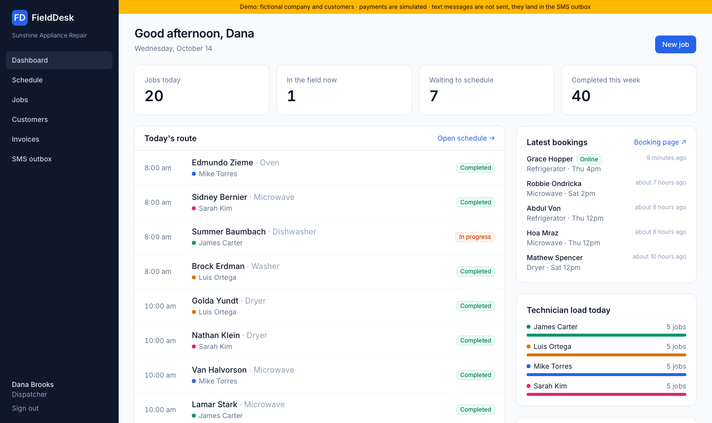

## What it does

**For the office (admin, dispatcher)**
- Dashboard: today's route, who is in the field right now, jobs waiting to be scheduled, technician load, lead sources for the last 30 days
- Schedule board: one column per technician, jobs placed on a time grid
- Customers with several service addresses, gate codes and access notes, and full job history
- Jobs with a status workflow: `unscheduled → scheduled → en route → in progress → completed`, plus cancel with a required reason
- Search customers by name, by a phone number in any format, or by email

**For technicians: their own cabinet**
- A phone-first view of today's jobs, the next 7 days and recent completions
- One-tap buttons: *On my way → Start work → Complete job*
- Call the customer, open the address in Maps, add notes and upload photos from the camera
- A technician sees only their own jobs and can move them only through the field statuses

**Billing**
- Invoice any job with labor, parts and fee lines. Sales tax applies to parts only, at the company rate
- Text the invoice to the customer: they get a link to a payment page that needs no login and shows only their first name, city and the lines
- Take payment by link (online) or record cash, check or card taken on site. Partial payments supported; a receipt is texted every time
- PDF invoice for the office and for the customer
- Outstanding balance, overdue flag, money collected this month

**Customer texts**
- *On my way* when the technician taps it, a review request two hours after the job is completed, the invoice link, and payment receipts
- Every text is stored and shown in the SMS outbox with its status

**For the admin**
- Team management: add people, set roles and calendar colors, reset passwords, deactivate (never delete, so history keeps its authors)
- Audit log of every sign-in, failed sign-in, denied access and data change, with who, when, what changed and from which IP

| Schedule | Job | Audit log |
|---|---|---|
| 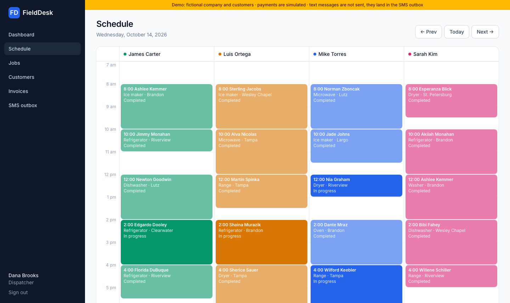 | 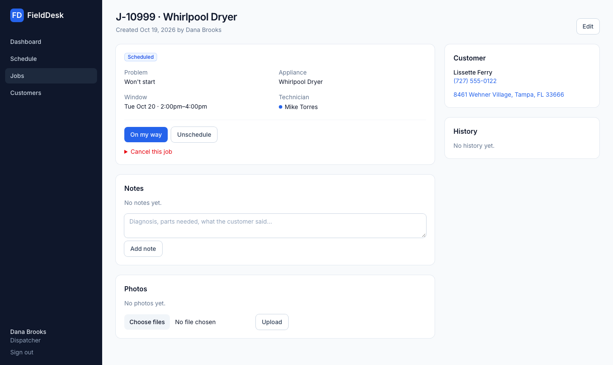 | 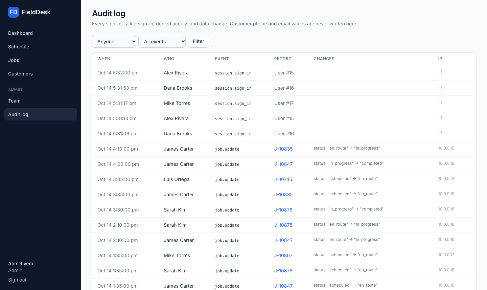 |

| Technician: today | Technician: job | Technician: invoice on site |
|---|---|---|
| 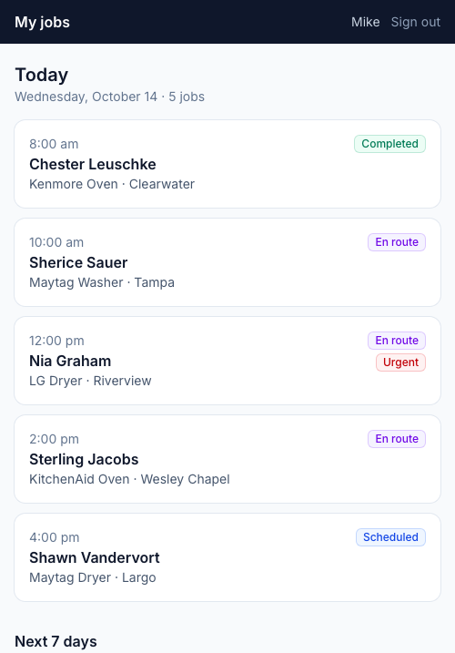 | 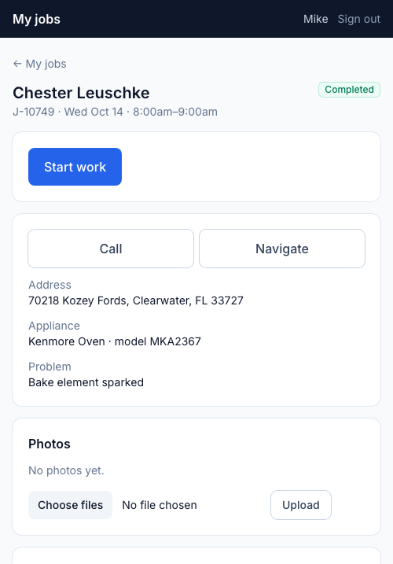 | 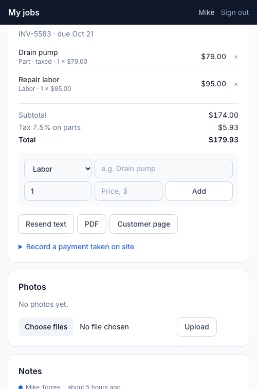 |

| Invoices | Customer pay page | Checkout (simulated) | SMS outbox |
|---|---|---|---|
| 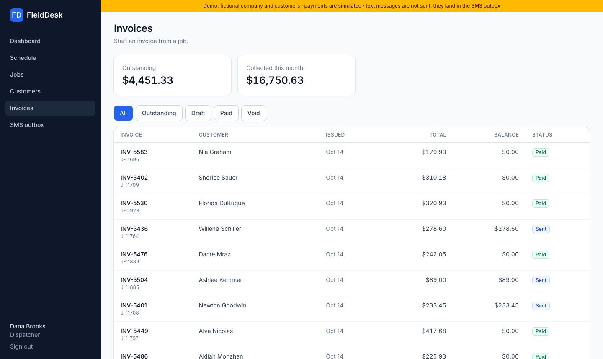 | 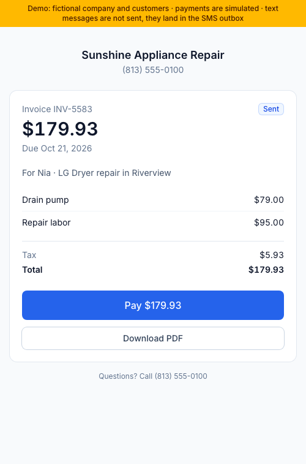 | 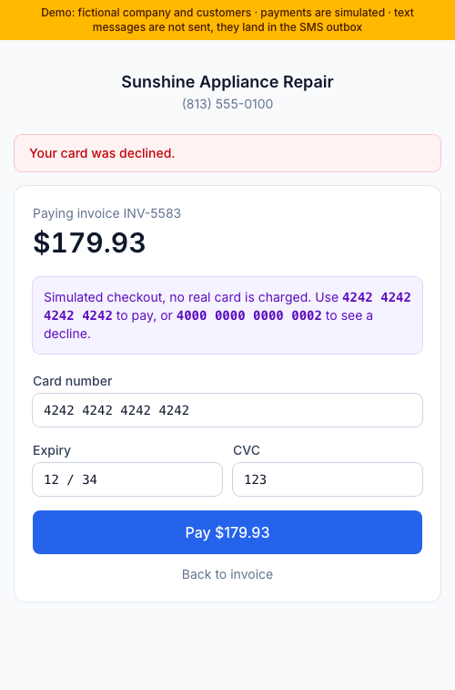 | 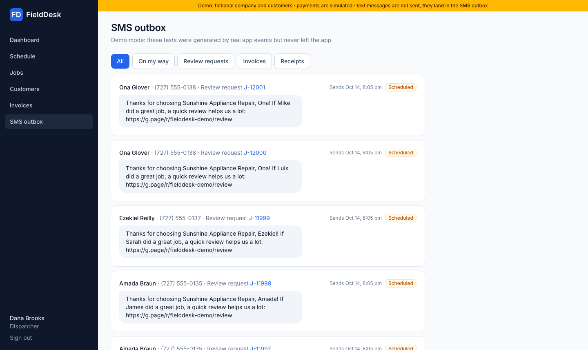 |

## Demo mode: what is real and what is simulated

The demo runs with no third-party accounts. A yellow bar on every page says so.

| Part | In the demo | In production |
|---|---|---|
| Data | Fictional company and customers from Faker; phones in the 555-01XX range | Your data |
| Payments | `PaymentGateways::Simulated`: a checkout page that accepts the test card `4242 4242 4242 4242` and declines `4000 0000 0000 0002` | `PaymentGateways::Stripe`: Stripe Checkout plus a signed webhook. Set `STRIPE_SECRET_KEY` (a `sk_test_` key works) and `STRIPE_WEBHOOK_SECRET` |
| Texts | `SmsProviders::Simulated`: stored with status *simulated* and shown in the outbox | `SmsProviders::Twilio`. Set `TWILIO_ACCOUNT_SID`, `TWILIO_AUTH_TOKEN`, `TWILIO_FROM_NUMBER` and turn demo mode off |

Everything around the provider is the same code in both modes: invoice math, payment recording and idempotency, receipts, message templates, background delivery and retries. The Stripe webhook is covered by a test that signs a payload the way Stripe does.

## Security

| Concern | How it's handled |
|---|---|
| Passwords | Rails 8 built-in authentication, `has_secure_password` with bcrypt. Minimum 10 characters. Only the hash is stored. |
| Brute force | Sign-in and password reset are rate-limited (10 attempts per 3 minutes); failed sign-ins are logged with the IP. |
| Sessions | Database-backed, httpOnly signed cookie. A password change or deactivation ends the person's sessions everywhere, and a deactivated user is signed out on their next request. |
| Customer PII | Phone and email are encrypted at rest with Active Record Encryption. Deterministic mode keeps exact-match search working. Production refuses to boot without real keys. |
| Logs | Phone, email, password and token params are filtered from request logs. The audit log writes `[FILTERED]` for encrypted columns and password digests, so it never becomes a second copy of PII. |
| Payment links | 24+ character random token per invoice; draft invoices are not reachable; payment endpoints are rate-limited; gateway charges are recorded once even if a webhook is delivered twice. |
| Authorization | Pundit policies on every action, enforced by `verify_authorized`. Policy scopes keep technicians inside their own jobs. Denied attempts land in the audit log. |
| Static analysis | Brakeman and bundler-audit run in CI. |

## Design notes

- **State machine without a gem.** `Job::TRANSITIONS` is a plain hash; `Job#allowed_transitions_for(user)` combines it with the role, so the buttons in the UI and the server-side check come from the same rule.
- **Auditing as a concern.** `Auditable` hooks into `after_*_commit`, so a rolled-back transaction never leaves a phantom log entry. The acting user and IP come from `Current`.
- **Job numbers from a Postgres sequence** (`J-10001`, …), so two dispatchers booking in the same second never collide. That's why the schema lives in `db/structure.sql`.
- **Providers behind small adapters.** `PaymentGateways.current` and `SmsProviders.current` pick the implementation from ENV. Real SMS can never go out while demo mode is on.
- **Texts are records first, deliveries second.** `Messaging.notify` saves an `OutboundMessage`, then `DeliverMessageJob` sends it, so a slow provider never blocks the technician's tap, scheduled texts survive restarts, and a review request for a job canceled in the meantime is skipped.
- **Money in integer cents**, tax rounded once per invoice.
- **Solid Queue, Solid Cache, Solid Cable**: background jobs, cache and websockets all run on Postgres. One database to operate.

## Running it locally

Requirements: Ruby 4.0, PostgreSQL 17.

```bash
git clone https://github.com/IgorOdaryuk/fielddesk.git
cd fielddesk
bin/setup          # installs gems, creates and seeds the database, starts the server
```

Open http://localhost:3000 and sign in with any demo account. The password for all of them is `demo-password`:

| Role | Email |
|---|---|
| Admin | `admin@fielddesk.demo` |
| Dispatcher | `dispatch@fielddesk.demo` |
| Technician | `mike@fielddesk.demo`, `sarah@…`, `james@…`, `luis@…` |

The demo data is generated by Faker: a fictional repair company in the Tampa Bay area. Phone numbers use the 555-01XX range reserved for fiction. `RESEED=1 bin/rails db:seed` rebuilds it.

## Tests

```bash
bin/rails test     # models, policies, and the full dispatcher and technician flows
bin/ci             # the same checks CI runs: RuboCop, Brakeman, bundler-audit, tests, seeds
```

## Deploying

Production needs these environment variables:

```
DATABASE_URL
SECRET_KEY_BASE
AR_ENCRYPTION_PRIMARY_KEY
AR_ENCRYPTION_DETERMINISTIC_KEY
AR_ENCRYPTION_KEY_DERIVATION_SALT
APP_HOST
```

Generate the three encryption values with `bin/rails db:encryption:init`. Optional: `STRIPE_*` and `TWILIO_*` from the table above, `COMPANY_NAME`, `COMPANY_PHONE`, `COMPANY_TAX_RATE_BPS` (750 = 7.5%). Set `DEMO_MODE=1` to show the demo logins and the demo bar, and to force simulated texts.

## Roadmap

- [x] Invoices with line items, PDF export, and payment links (simulated or Stripe Checkout)
- [x] Customer texts: on my way, review request, invoice link, receipt (outbox or Twilio)
- [ ] Drag-and-drop rescheduling on the schedule board (Stimulus)
- [ ] Live status updates on the dashboard over Turbo Streams
- [ ] CSV import of customers and job history

## License

MIT
